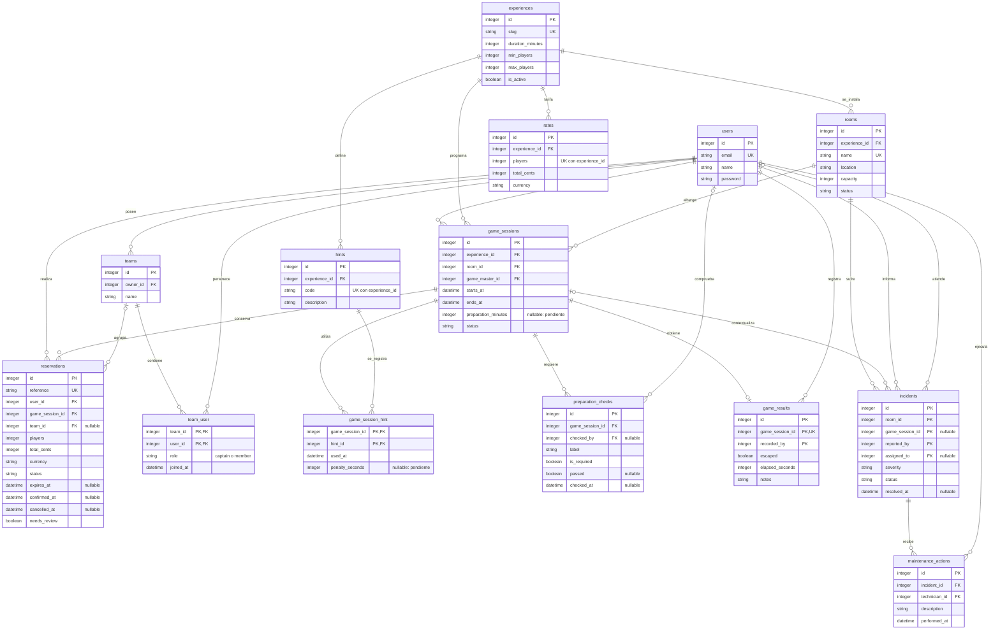

# Modelo de datos de Mythos - Sprint 2

Revisión: 16/10/2026. Implementación: Laravel 13, PHP 8.4 y SQLite, elegidos con el alumno. Fechas almacenadas en UTC; las interfaces posteriores mostrarán la zona del negocio. Importes en céntimos enteros y moneda explícita; no se confunden importes reservados con cobros.

## Entidades y justificación

| Modelo / tabla | Responsabilidad y atributos principales |
|---|---|
| User / users | Identidad y contacto de cliente o personal. Nombre, email único y contraseña cifrada. Los roles se implementarán en S3. |
| Experience / experiences | Juego o historia: nombre, slug único, descripción, duración, mínimo/máximo de jugadores y activo. |
| Room / rooms | Sala física: experiencia, nombre único, ubicación, aforo y estado operativo. Se separa del juego para gestionar horarios y mantenimiento. |
| Rate / rates | Precio total por experiencia y número de participantes; combinación única, importe y moneda. |
| GameSession / game_sessions | Sesión programada: experiencia, sala, game master, inicio, fin, estado y margen de preparación opcional. |
| Reservation / reservations | Titular, sesión, equipo opcional, participantes, referencia única, precio acordado, moneda, estado, fechas y señal de revisión. Conserva el histórico. |
| Team / teams | Equipo y propietario. Los miembros con cuenta están en una N:N; el aforo de la reserva incluye también participantes sin cuenta. |
| Hint / hints | Catálogo de pistas de una experiencia, con código único dentro de ella. No contiene soluciones reales del negocio en los datos demo. |
| PreparationCheck / preparation_checks | Comprobación previa, sesión, texto, obligatoriedad, responsable, resultado y fecha. |
| GameResult / game_results | Resultado único por sesión: autor, éxito, segundos empleados y notas. No presupone diploma ni valoración. |
| Incident / incidents | Avería de sala, sesión opcional, informante, técnico asignado, descripción, gravedad, estado y resolución. |
| MaintenanceAction / maintenance_actions | Intervenciones de una incidencia, técnico, descripción y fecha. Se separan para mantener varias actuaciones e histórico. |

Son **12 modelos de entidad**, además de dos clases Pivot: TeamMembership y HintUsage. El esquema incluye las tablas técnicas de Laravel para sesiones, recuperación de contraseñas, caché y colas; su presencia no significa que estén implementadas las funciones de otros sprints.

## Diagrama entidad-relación

Los círculos indican que puede no existir todavía un registro relacionado. Las dos tablas intermedias materializan las relaciones N:N.

Todas las tablas de dominio incluyen `created_at` y `updated_at`. El detalle ejecutable de columnas, tipos, nulabilidad y restricciones está en `database/migrations/2026_10_16_000001_create_mythos_domain.php`.

## Cardinalidad y decisiones de estructura

- Una sala tiene una experiencia instalada; una experiencia puede estar en varias salas. La sesión conserva ambas referencias y una clave compuesta impide asignarle una experiencia distinta de la sala. Cambiar la instalación de una sala con sesiones históricas requiere un cambio explícito de diseño, no sobrescribir su referencia.
- Una sesión conserva varias reservas históricas, pero admite como máximo una en estado `pending` o `confirmed`. La cancelación o caducidad libera ese puesto sin borrar la reserva. El flujo futuro deberá rechazar reservar sesiones completadas o canceladas.
- Los miembros de equipo y las pistas utilizadas son N:N. Las claves compuestas impiden duplicar una pareja. Cada pista utilizada se registra una vez por sesión con su momento y posible penalización.
- Una sesión tiene cero o un resultado, varias comprobaciones y posibles incidencias. Una incidencia puede existir sin sesión; si la tiene, la sala debe coincidir mediante clave compuesta.
- El rol `captain/member` es la función dentro del equipo, **no** un rol de Laravel-permission. Las Policies posteriores deberán autorizar quién puede alterar miembros o asignaciones.

## Integridad, restricciones e índices

- Claves ajenas activas en SQLite y `ON DELETE RESTRICT` para reservas, sesiones, usuarios y registros operativos con dependencias: no se elimina su histórico en cascada. Solo la membresía de un equipo se elimina en cascada al borrar un equipo que no esté referenciado por reservas.
- `CHECK`: duración y aforos positivos, límites ordenados, importes y penalizaciones no negativos, fin posterior al inicio, valores de estado/gravedad válidos, comprobaciones completas o aún pendientes, resolución de incidencias coherente con su fecha.
- Índice único parcial `reservations_one_active_per_session`: protege reservas activas incluso frente a dos escritores. Se prueba el bloqueo de SQLite y el rechazo por unicidad al reintentar, mediante conexiones PDO independientes.
- Triggers de INSERT y UPDATE: aforo de reserva compatible con experiencia y sala; tarifas dentro del rango; pistas de la misma experiencia; sesiones sin solapamiento de sala o game master. Los márgenes explícitos de preparación se consideran en el cálculo.
- Índices para agenda por sala/fecha y responsable/fecha; catálogo y sesiones por experiencia/estado/fecha; reservas por titular/estado, equipo y caducidad; incidencias por sala/gravedad/estado, sesión y técnico; actuaciones por incidencia/fecha.
- El motor elegido es SQLite. La migración usa SQL explícito para CHECK, índices parciales y triggers que el constructor de esquema no expresa igual. Antes de cambiar a MySQL hay que portar esas garantías y repetir las pruebas; no se afirma compatibilidad sin comprobarla.

## Siete modelos preparados para la API

| Modelo | Uso previsto para S6 |
|---|---|
| Experience | CRUD completo del catálogo, con escritura administrativa protegida. |
| Reservation | CRUD completo con autenticación, permisos y restricciones de cancelación/baja. |
| GameSession | Consulta de agenda y disponibilidad. |
| Room | Consulta de salas y capacidad autorizada. |
| Team | Consulta de equipos del usuario autorizado. |
| Incident | Consulta de incidencias por personal autorizado. |
| MaintenanceAction | Consulta de intervenciones por personal autorizado. |

Se preparan los modelos y relaciones, no endpoints. El enunciado nuevo amplía la previsión inicial de tres modelos; los dos CRUD completos se mantienen. No se marca HU-10 como implementada.

## Datos de prueba y cuestiones pendientes

`MythosDemoSeeder` crea seis personas ficticias con correos `@example.test`, una experiencia de referencia, dos salas demo, cinco tarifas, cinco sesiones y reservas de estados diferentes, un equipo con dos miembros, dos pistas, una utilización, tres comprobaciones, un resultado, dos incidencias y una intervención. Puede ejecutarse dos veces sin duplicar estos registros. Las fechas son fijas para que el resultado sea reproducible; no pretenden representar siempre próximas reservas.

Las tarifas son la instantánea consultada en septiembre de 2026, no una verificación de precios actuales. Las salas y personas demo no son un inventario real ni clientes del negocio. Las factories generan datos sintéticos relacionados y se comprueban individualmente. Las credenciales demo son exclusivamente locales; no existe todavía pantalla de acceso.

Siguen pendientes con el alumno: antelación de cancelación, caducidad de pendientes, margen de preparación, confirmación/cobro, inventario inicial completo, diploma y penalización de pistas. Por eso `expires_at`, `preparation_minutes` y `penalty_seconds` pueden ser nulos. Un nulo expresa falta de decisión, no una regla de negocio de cero minutos. El trigger de agenda usa cero únicamente como límite técnico cuando no existe margen configurado.

A5 (borrado lógico) no se incluye como ampliación implementada. La protección de histórico se cubre con estados y claves restrictivas; no equivale a `SoftDeletes`. Autorización, cálculo definitivo de precio desde servidor, cancelación, bloqueos críticos y revisión automática de reservas afectadas se implementarán en sus historias. Este sprint deja los datos necesarios; no declara completos esos flujos.
